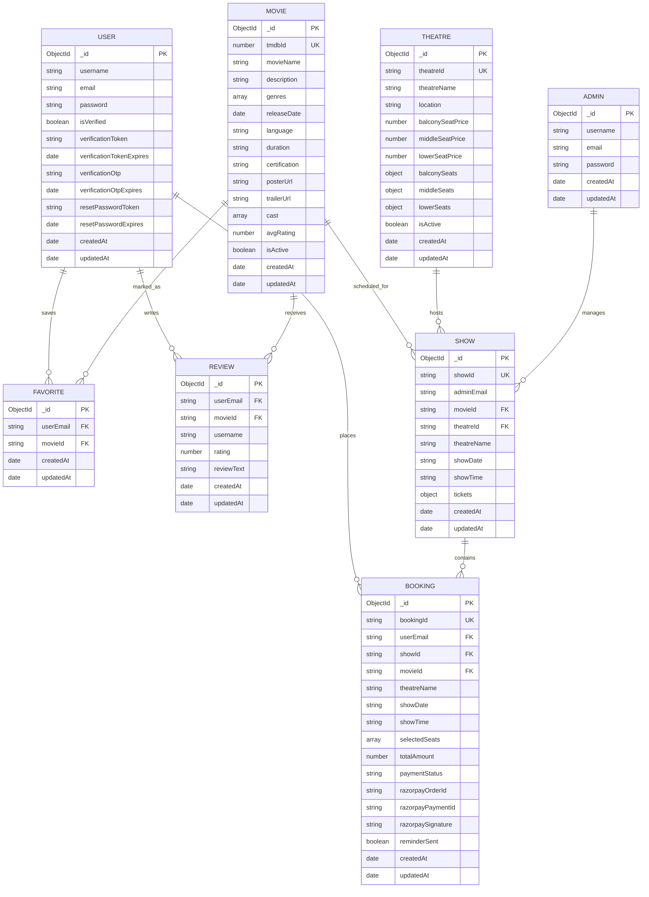

# 📊 Entity-Relationship (ER) Diagram

This document models the relational entity structures and cardinality constraints across MongoDB collections in the **iMovies** platform.

---

## 📐 Mermaid.js ER Diagram

---

## 🧩 Schema Relationships & Structural Details

### 1. `USER` & `ADMIN`
- **Separation of Concerns**: Customers register in the `User` schema with automated email verification and OTP tokens. Platform administrators authenticate via the `Admin` schema or fallback verification, receiving elevated JSON Web Tokens (`isAdmin: true`).
- **Security**: Passwords in both collections are salted and hashed with **bcryptjs** (10 salt rounds).

### 2. `THEATRE` & `SHOW`
- **Dynamic Tiering**: The `Theatre` collection stores granular seat map objects (`balconySeats`, `middleSeats`, `lowerSeats`), where each key represents a physical coordinate (e.g., `A1`, `B5`, `F12`).
- **Screening Snapshot**: When a `Show` is initialized, it clones the theatre's seat architecture into a stateful `tickets` dictionary tracking real-time status: `'available'`, `'locked'`, or `'booked'`.

### 3. `MOVIE`, `SHOW`, & `BOOKING`
- **Cardinality**: A single `Movie` has many `Show` schedules distributed across multiple `Theatres`.
- **Atomic Locking & Booking**: A `Booking` aggregates chosen seat labels (`selectedSeats`), calculates billing, and establishes a bidirectional lock lifecycle with automated 10-minute expiry.

### 4. `REVIEW` & `FAVORITE`
- **Compound Uniqueness**: Both collections utilize compound indexing (`{ userEmail: 1, movieId: 1 }`) to ensure a user can only review and favorite a given movie once without duplicate records.
