# 🧭 User Flow & Request Journey Diagram

This document illustrates the end-to-end journey of customers and administrators through the **iMovies** cinema platform, covering authentication, live seat reservation, Razorpay checkout, and automated notification delivery.

---

## 🎬 Comprehensive User Journey Diagram

```mermaid
flowchart TD
    %% Entry & Auth
    Start(["User Lands on Website"]) --> AuthChoice{"Authenticated?"}
    AuthChoice -- "No" --> LandingPage["Landing Page / CTA"]
    LandingPage --> RegOrLogin{"Action"}
    
    RegOrLogin -- "Register" --> RegForm["Register Form"]
    RegForm --> SendBrevoOTP["Backend Issues 6-Digit OTP & Email Token via Brevo"]
    SendBrevoOTP --> VerifyPage["Verify Email Screen (Enter OTP or Click Link)"]
    VerifyPage --> AuthSuccess["Account Verified & JWT Issued"]
    
    RegOrLogin -- "Forgot Password" --> ForgotPass["Request Reset Link"]
    ForgotPass --> ResetEmail["Brevo Dispatches Secure Reset URL"]
    ResetEmail --> SetNewPass["Set New Password Page"]
    SetNewPass --> LoginForm["Login Form"]

    RegOrLogin -- "Login" --> LoginForm
    LoginForm --> AuthSuccess

    %% Browsing & Movie Selection
    AuthChoice -- "Yes" --> HomePage["Home Page: Live TMDB Feeds & Search"]
    AuthSuccess --> HomePage

    HomePage --> FilterAction["Filter by Genre, Language, City, or Search Query"]
    FilterAction --> MovieDetails["Movie Details Page: Cast, Trailer, Reviews, Synopsis"]
    MovieDetails --> WatchlistToggle["Toggle Watchlist / Submit Star Review"]
    MovieDetails --> ClickBook["Click 'Book Tickets'"]

    %% Show & Theatre Selection
    ClickBook --> ShowsPage["Movie Shows Page: Select Date (Next 7 Days)"]
    ShowsPage --> FilterShows["Group Screenings by Active Theatres"]
    FilterShows --> PickShowtime["Select Available Showtime (Past Times Disabled)"]
    
    %% Interactive Seat Map & Socket.io Locking
    PickShowtime --> SeatMap["Interactive Seat Map (Balcony, Middle, Lower)"]
    SeatMap --> SocketConnect["Join Socket.io Room (showId)"]
    SocketConnect --> ClickSeats["Select Available Seats"]
    ClickSeats --> LockRequest["Click 'Lock Seats' -> POST /api/bookings/lock"]
    
    LockRequest --> LockVerify{"Seats Available?"}
    LockVerify -- "No (Conflict)" --> LockFail["Toast: 'Seats already reserved or locked'"]
    LockFail --> SeatMap
    
    LockVerify -- "Yes" --> BroadcastLock["Socket.io Emits 'seats-locked' to Other Clients"]
    BroadcastLock --> StartTimer["10-Minute Lock Countdown Timer Starts"]
    
    %% Checkout & Razorpay Integration
    StartTimer --> CheckoutInit["Click 'Proceed to Payment'"]
    CheckoutInit --> CreateOrder["Backend Calls Razorpay Orders API (Key Secret Safe)"]
    CreateOrder --> RazorpayModal["Frontend Launches Razorpay Checkout Modal (Key ID)"]
    
    RazorpayModal --> PayDecision{"Payment Status"}
    PayDecision -- "Dismissed / Failed" --> PayFailed["Payment Cancelled or Failed"]
    PayFailed --> ReleaseSeats["Auto-release / Cleanup Expired Locks"]
    ReleaseSeats --> SeatMap
    
    PayDecision -- "Success" --> VerifySignature["Frontend Sends order_id, payment_id, signature to Backend"]
    VerifySignature --> HMACCheck{"HMAC-SHA256 Match?"}
    HMACCheck -- "Invalid" --> TamperAlert["Transaction Rejected"]
    
    HMACCheck -- "Valid" --> ConfirmBooking["Seats Marked 'booked' in MongoDB"]
    ConfirmBooking --> SocketBooked["Socket.io Broadcasts 'seat-status-update'"]
    ConfirmBooking --> BrevoEmail["Brevo Dispatches HTML Confirmation & Digital Ticket"]
    ConfirmBooking --> BookingHistory["User Redirected to My Bookings Page"]
    
    %% Lifecycle Completion
    BookingHistory --> ViewPrintTicket["View / Print Ticket or Rate Experience"]
    BookingHistory --> CronReminder["Node-Cron Sends Reminder 24h Before Showtime"]
    CronReminder --> EndNode(["Screening Day: Enjoy the Movie!"])
```

---

## 🔁 State Progression Table

| Stage | Client Action | Backend Processing | Data / Socket Event |
| :--- | :--- | :--- | :--- |
| **1. Registration** | Enters credentials & submits | Hashes password, generates crypto token & 6-digit OTP | Brevo API dispatches activation email |
| **2. OTP Verification** | Inputs OTP into modal | Validates OTP expiry & activates user | JWT token stored in `localStorage` |
| **3. Catalog Browsing** | Search or filter by genre/city | Queries MongoDB & live TMDB API | Clean JSON list with average rating |
| **4. Seat Map** | Opens `/seatslug/:showId` | Fetches show & checks real-time seat states | Client joins room: `socket.emit('join-show')` |
| **5. Seat Locking** | Selects seats & confirms | Atomically marks seat `'locked'` with 10m expiry | `socket.to(showId).emit('seats-locked')` |
| **6. Razorpay Order** | Clicks payment button | Creates order with server-side secret | Returns `order_id` to frontend |
| **7. Verification** | Completes UPI/Card checkout | Verifies cryptographic signature using HMAC-SHA256 | Marks booking `'Completed'`, seats `'booked'` |
| **8. Delivery** | Sees confirmation toast | Sends Brevo email receipt with ticket summary | Emits updated seats to all connected viewers |
| **9. Auto-Cleanup** | User abandons checkout | `cleanupService` cron frees expired locks | `socket.emit('seat-status-update')` |
